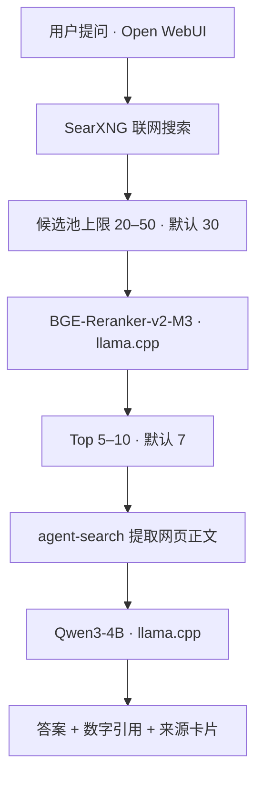

# ForSLM Local AI Search

Windows 本地小模型联网搜索。复用 **Open WebUI + agent-search + SearXNG + llama.cpp**，使用 **BGE-Reranker-v2-M3** 重排，再由 **Qwen3-4B** 生成带来源引用的答案。

本仓库提供安装与启动脚本、Open WebUI Pipe、必要的上游补丁和配置模板。聊天界面、搜索、去重、重排客户端和正文提取都来自现有项目。



**候选数量是上限，不是保证值。** 不足时使用已有结果并显示真实数量。当前上游 Bing 引擎没有翻页支持，仅 Bing 可用时常见候选数量是 10 条。BGE 失败会显示错误；网页正文读取失败时使用搜索摘要并提示。

## 准备环境

- Windows 10/11 **x64**，PowerShell 5.1 或更新版本。
- [Git for Windows](https://git-scm.com/downloads/win) 和 [Node.js](https://nodejs.org/) **20.18.1 或更新版本**，加入 PATH；需能运行 `git`、`node`、`npm.cmd`。
- 可以访问 GitHub、PyPI 及搜索网站的网络。
- 已下载的 [llama.cpp](https://github.com/ggml-org/llama.cpp/releases) `llama-server.exe` 及其运行库。
- 两个本地 GGUF 模型：
  - `Qwen3-4B-Q5_K_M.gguf`，来源模型：[Qwen/Qwen3-4B](https://huggingface.co/Qwen/Qwen3-4B)。
  - `BGE-Reranker-v2-M3-Q5_K_M.gguf`，来源模型：[BAAI/bge-reranker-v2-m3](https://huggingface.co/BAAI/bge-reranker-v2-m3)。

安装器自动下载项目专用 uv 和 Python 3.11.17，创建独立 Python 环境。无需预装 Python、Docker 或 WSL。**模型和 llama.cpp 不随包分发，也不会由安装器自动下载**；使用已有文件并填写路径。其他兼容 GGUF 量化版本也可通过路径配置。

本机部署参考：RTX 5050 8GB，Qwen 上下文 32768、BGE 上下文 8192，两个模型使用 GPU。内存占用取决于量化、上下文和 GPU 层数。

## 下载与安装

```powershell
git clone https://github.com/f246813/ForSLM-LocalAIsearch.git D:\ForSLM-LocalAIsearch
cd D:\ForSLM-LocalAIsearch
.\Install.cmd
```

也可从 [Releases](https://github.com/f246813/ForSLM-LocalAIsearch/releases) 下载 ZIP，解压到固定目录后双击 `Install.cmd`。可以安装到其他盘符或路径。

安装器会下载指定版本的 uv/Python，按 `config/versions.json` 的提交获取 agent-search、SearXNG，应用补丁并使用上游 `package-lock.json` 编译 agent-search。Open WebUI 使用官方带预构建前端的 PyPI 0.12.0 包和锁定的 slim 依赖。SearXNG 使用稀疏检出排除 Windows 不支持的 Linux 模板文件名。

安装器可以再次运行，不覆盖已有本机配置。若上游源码已切换版本或修改了补丁涉及的代码，会保留现场并报告冲突，建议在新目录安装。可用 `Install.ps1 -UVPath '你的uv.exe路径'` 指定已有 uv。

## 配置模型

编辑安装器生成的 `config/local.json`，把前三个路径改为真实文件位置：

```json
{
  "llama_server": "D:\\llama.cpp\\llama-server.exe",
  "qwen_model": "D:\\llama.cpp\\models\\Qwen3-4B-Q5_K_M.gguf",
  "reranker_model": "D:\\llama.cpp\\models\\BGE-Reranker-v2-M3-Q5_K_M.gguf",
  "gpu_layers": 99,
  "qwen_context": 32768,
  "reranker_context": 8192
}
```

JSON 中反斜杠写作 `\\`。显存不足时减少 `gpu_layers` 或上下文长度；`gpu_layers: 0` 使用 CPU。此设置同时控制两个模型的 GPU 层数。

如模型服务已分别运行在 `127.0.0.1:8080` 和 `127.0.0.1:8081`，启动脚本会复用。确认端口对应 Qwen 与 BGE。

## 启动与使用

双击 **Start.cmd**，或运行：

```powershell
.\Start.cmd
# 不自动打开浏览器：
powershell.exe -NoProfile -ExecutionPolicy Bypass -File .\Start.ps1 -NoBrowser
```

等待服务就绪，打开 **http://127.0.0.1:3000**：

1. 选择默认模型 **Qwen3-4B · 联网搜索**。
2. 输入问题，例如「什么是 MCP（Model Context Protocol）？」。
3. 状态栏显示搜索、实际候选数量、BGE Top K 和回答进度。
4. 回答中 `[1]` 等引用对应来源卡片，可查看资料并打开原网页。

普通问答执行搜索。追问会先由 Qwen 结合最近对话整理独立查询；Open WebUI 自动标题等后台任务直接使用 Qwen。

双击 **Stop.cmd** 关闭本项目启动的服务及其 Python 子进程。通过 PID、启动时间、程序路径识别进程；复用的现有模型服务不会被停止。

| 服务 | 默认地址 |
| --- | --- |
| Open WebUI | http://127.0.0.1:3000 |
| SearXNG | http://127.0.0.1:8888 |
| Qwen API | http://127.0.0.1:8080/v1 |
| BGE rerank API | http://127.0.0.1:8081/v1/rerank |

默认仅绑定本机，采用 Open WebUI 无登录单用户模式。模型推理在本机进行，搜索查询和网页读取会访问互联网。

## 搜索设置

Open WebUI **工作区 → 函数 → Qwen3-4B · 联网搜索**（ID：`local_ai_search`）的 Valves：

| 参数 | 默认值 | 用途 |
| --- | --- | --- |
| `Candidate_Count` | 30 | 候选池上限，范围 20–50 |
| `Top_K` | 7 | BGE 保留数量，范围 5–10 |
| `Qwen_URL` | `http://127.0.0.1:8080/v1` | 回答模型 API |
| `BGE_URL` | `http://127.0.0.1:8081/v1` | 重排 API |
| `SearXNG_URL` | `http://127.0.0.1:8888` | 搜索服务 |
| `Node_Path` | 自动寻找 Node.js | Node 可执行程序 |

更改 API 地址只影响 Pipe，不修改启动脚本的默认端口。

SearXNG 配置在 `config/searxng.yml`。模板启用 Bing、DuckDuckGo、Brave、百度、Wikipedia；Google 保留但默认未启用。Bing 直接使用 `https://cn.bing.com`，避免本机网络下 `www.bing.com` 的地域跳转产生空结果；其他地区可按实际网络改为 `https://www.bing.com`。修改后用 Stop/Start 重启。

如需代理，使用 SearXNG 原生 `outgoing.proxies` 配置；agent-search 网页读取使用其原生 `HTTP_PROXY` / `HTTPS_PROXY` 环境变量。

## 常见问题

- **搜索未返回结果：**查看 `logs/searxng.err.log`、`logs/agent-search.log`。验证码、限流、访问拒绝会使失败引擎暂时停用。先到 http://127.0.0.1:8888 直接搜索。Bing 空结果时检查地域域名配置；模板已包含 `cn.bing.com` 修复。
- **候选不足 30 条：**上限不等于实际数量；重复 URL 会去重，部分引擎可能不可用，当前 Bing 没有翻页支持。不会补造网页。
- **BGE 失败：**确认 8081 是 BGE-Reranker-v2-M3，用 `--embedding --pooling rank --reranking` 启动并支持 `/v1/rerank`。启动脚本已包含这些参数。
- **模型启动失败：**检查路径、llama.cpp 运行库、`logs/qwen.err.log`、`logs/bge.err.log`。显存不足时减少 GPU 层数或上下文。
- **安装下载失败：**确认能访问 GitHub 和 PyPI，再运行安装器。首次安装会下载约百 MB 的 Open WebUI 包和其他依赖，不会下载大模型。

## 目录与上游复用

```text
Install.cmd / Install.ps1       安装上游组件与环境
Start.cmd / Start.ps1           启动模型、搜索、网页
Stop.cmd / Stop.ps1             停止项目创建的进程
config/*.example.*             无密钥配置模板
config/versions.json           上游版本
config/*-requirements.lock.txt  Python 依赖
integration/local_search_pipe.py    Open WebUI Pipe
integration/register-pipe.py        官方 Functions API 注册
integration/search-bridge.mjs       连接 agent-search 模块
integration/serve-searxng.py         Waitress 运行官方 Flask 应用
integration/*.patch                最小上游补丁
licenses/                      上游许可证
runtime/ upstream/ data/ logs/  本机生成，不发布
```

本机 `config/local.json`、`config/searxng.yml`、`.webui_secret_key`、运行环境、聊天记录、日志和模型均由 `.gitignore` 排除。发布 ZIP 来自 Git 跟踪文件。

| 上游 | 复用方式 | 许可证 |
| --- | --- | --- |
| [Open WebUI](https://github.com/open-webui/open-webui) | 官方 PyPI 包、原生界面和 Functions | Open WebUI License |
| [agent-search](https://github.com/sebrinass/agent-search) | 锁定源码，搜索/重排/正文提取 | MIT |
| [SearXNG](https://github.com/searxng/searxng) | 锁定源码，官方 Flask 应用 | AGPL-3.0-or-later |
| [llama.cpp](https://github.com/ggml-org/llama.cpp) | 用户提供程序，通过 HTTP API 连接 | MIT |

本仓库原创连接代码与脚本使用 **AGPL-3.0-or-later**，见 [LICENSE](LICENSE)。上游代码、补丁涉及的原始代码和模型遵循各自许可证，见 [THIRD_PARTY_NOTICES.md](THIRD_PARTY_NOTICES.md)。保留 Open WebUI 品牌与界面。

补丁只涉及 agent-search 候选池上限、真实候选数、BGE 必须执行与失败提示，以及 SearXNG 可选 Valkey 日志的 Windows `pwd` 兼容。

## 已完成的本机运行

Windows 本机通过 Open WebUI `/api/chat/completions` 已完成 MCP 问题的搜索、BGE Top 7、网页读取、Qwen 引用回答，HTTP 200，约 10.5 秒。发布版安装器已在当前环境完成重复安装、上游编译与依赖安装；尚未在另一台干净机器上验证。
